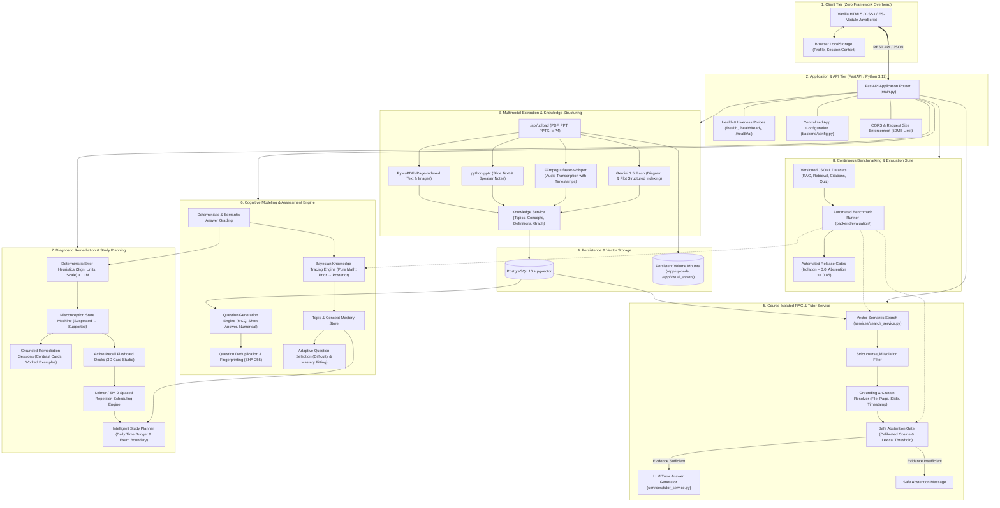

# VIDYA-X AI — System Architecture & Data Flow

**Project:** VIDYA-X AI — Your Course-Aware, Adaptive & Multimodal AI Tutor  
**Track:** Multimodal AI Hackathon 2026 — Track D: Personalized Tutoring & Adaptive Learning  
**Architecture Version:** 1.0.0 (Production Verified)

---

## 1. High-Level System Architecture Diagram



---

## 2. Component Inventory & Data Contracts

### 2.1 Client Layer
- **No Heavy Frameworks**: Pure HTML5, CSS3, and modern ES-module JavaScript (`api.js`, `shell.js`, etc.).
- **Local Persistence**: Manages student profile, active course context, and session tokens via `localStorage['vidyaXProfile']`.
- **Dynamic Configuration**: `frontend/config.js` dynamically determines whether to communicate via same-origin reverse proxy or direct development API at `http://localhost:8000`.

### 2.2 Multimodal Ingestion Pipeline
- **PyMuPDF (`fitz`)**: Parses PDF page by page (1-indexed). Extracts clean text blocks and embedded image byte streams.
- **python-pptx**: Traverses slide shapes, extracts body text, table cells, and speaker notes with exact 1-indexed slide IDs.
- **FFmpeg & faster-whisper**: Extracts audio channels into temporary PCM buffers, runs local whisper model, and chunks text tagged with `[HH:MM:SS - HH:MM:SS]` millisecond-precise intervals.
- **Visual Intelligence**: Extracts figures, charts, and equations; calls Gemini 1.5 Flash (or generates local deterministic descriptors) to produce structured metadata (`labels`, `equations`, `relationships`).

### 2.3 Storage & Vector Database
- **PostgreSQL 16 with `pgvector`**: Stores course entities, structured knowledge units, and chunk embeddings.
- **Cosine Distance Metric**: Employs `<=>` operator over 384-dimensional dense vectors with index isolation:
  ```sql
  SELECT chunk_id, content, 1 - (embedding <=> :query_vector) AS similarity
  FROM knowledge_chunks
  WHERE course_id = :course_id
  ORDER BY embedding <=> :query_vector ASC
  LIMIT :top_k;
  ```
- **SQLite Fallback**: In test environments or when PostgreSQL is offline, `services/search_service.py` executes exact vector cosine similarity in pure Python with identical course isolation guarantees.

### 2.4 Cognitive Assessment & BKT Engine
- **Pure Mathematical Execution**: Bayesian Knowledge Tracing is implemented without LLM dependencies in pure Python (`services/bkt_service.py`).
- **Standard 4-Parameter Model**:
  - $P(L_0)$: Initial prior mastery probability (default: 0.20).
  - $P(T)$: Probability of learning transition given an opportunity (default: 0.15).
  - $P(G)$: Probability of a lucky guess on a question (default: 0.25 for 4-option MCQ).
  - $P(S)$: Probability of a careless slip when knowing the concept (default: 0.10).
- **Bayesian Update Formula**:
  $$\text{If Correct: } P(L_t \mid \text{Correct}) = \frac{P(L_{t-1}) \cdot (1 - P(S))}{P(L_{t-1}) \cdot (1 - P(S)) + (1 - P(L_{t-1})) \cdot P(G)}$$
  $$\text{If Incorrect: } P(L_t \mid \text{Incorrect}) = \frac{P(L_{t-1}) \cdot P(S)}{P(L_{t-1}) \cdot P(S) + (1 - P(L_{t-1})) \cdot (1 - P(G))}$$
  $$P(L_{t+1}) = P(L_t \mid \text{Obs}) + (1 - P(L_t \mid \text{Obs})) \cdot P(T)$$

---

## 3. Architecture Trade-offs & Engineering Bottlenecks

| Decision | Trade-Off Chosen | Rationale & Mitigation |
|---|---|---|
| **Vanilla JS vs. React/Next.js** | Avoided build tools, complex state hydration, and node bundle bloat. | Maximizes portability, guarantees sub-second page loads, and avoids client framework vulnerabilities. Shared navigation managed via `shell.js`. |
| **Course-Partitioned Vectors** | Enforced hard `WHERE course_id = :course_id` filtering in every vector search. | Completely eliminates data leakage between courses, even though shared global vector clustering is prevented. |
| **Deterministic BKT vs. Deep Knowledge Tracing (DKT)** | Chose classical 4-parameter BKT over neural DKT models. | BKT is completely explainable, requires zero GPU memory, executes in under 2ms, and operates reliably with small numbers of student attempts. |
| **Synchronous Extraction vs. Message Queues (Celery/RabbitMQ)** | Chose direct asynchronous background tasks in FastAPI for Hackathon release. | Eliminates Redis/RabbitMQ infrastructure overhead for local setup; long-running video transcription should be moved to a Celery/Redis queue for high concurrency enterprise deployments. |
